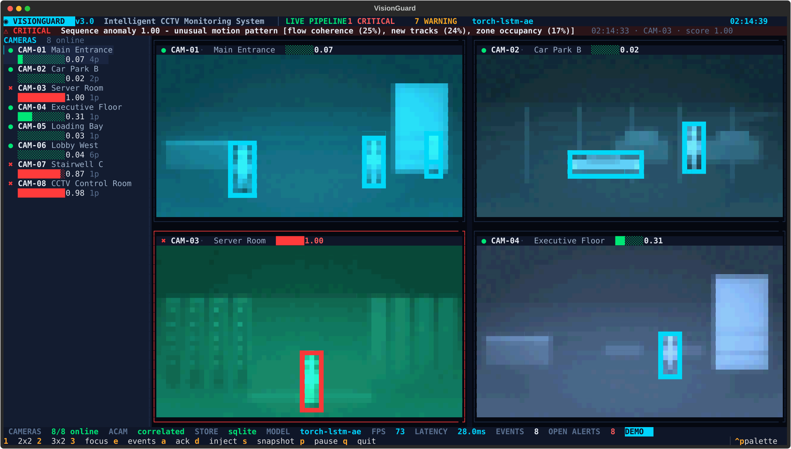

# VisionIQ

**A working CCTV analytics pipeline and terminal operator console — not an HTML mock-up.**

VisionIQ ingests frames, detects and tracks moving objects, learns what normal looks
like for each camera, raises explainable security events, and persists them. It runs
as a single Python process and renders its operator console in the terminal with
true-colour half-block pixels. There is no browser, no canvas animation and no
hard-coded "model accuracy" badge.

The original one-file mock-up is preserved untouched at the repository root:
`VisionIQ — Intelligent CCTV Monitoring System.html`.



---

## 1. What was actually in the original

The original is a single 705-line HTML document. It is a good visual design, but it
is a static mock-up, not a monitoring system:

| Area | Original implementation |
| --- | --- |
| UI | One HTML file; CSS layout; a little vanilla JavaScript |
| Camera list | Hard-coded array of 8 cameras with fixed names, zones and scores |
| "Live feeds" | `<canvas>` blobs moved with `requestAnimationFrame`; rectangles and ellipses, not video |
| "Detections" | `makeBlob()` creates random positions, sizes and confidence values |
| Anomaly flags | Random: `cam.score > 0.6 && Math.random() > 0.5` |
| Event log | A random entry from a 10-string array every 1.2–2.8 seconds |
| Model | None. The panel says "YOLO-v8 + LSTM-AE" |
| Accuracy claims | Hard-coded `AUROC 0.947` and `Recall 0.923` in the sidebar, model panel and about text |
| Persistence | None |
| Camera input | None |
| Backend | None |

Useful things kept from the original: the eight-camera deployment (names, zones,
capacity, access-controlled/restricted flags), the dark cyan/amber visual language,
the feed grid + detection log layout, the 02:14 night-shift scenario, and the
security vocabulary (tailgate, unbadged access, after-hours motion, loitering,
abandoned object, crowding, vehicle in a restricted area).

Everything else was rebuilt.

---

## 2. What this build does

```
synthetic scene / webcam / video file / RTSP
        │
        ▼
MotionDetector ── adaptive per-pixel background, frozen inside tracked boxes
        │
        ▼
Tracker ───────── IoU + centroid matching, velocity prediction, dwell time
        │
        ▼
FeatureExtractor ─ 12 per-camera scene features (counts, occupancy, motion,
        │           speed, dispersion, flow, new tracks, dwell)
        ▼
AnomalyScorer ─── PyTorch LSTM autoencoder (NumPy MLP fallback)
        │           trained only on normal warm-up windows
        │           threshold calibrated on held-out windows
        │           EMA smoothing + hysteresis
        ▼
CorrelationEngine ─ anomaly, crowding, loitering, unbadged access, tailgate,
        │            after-hours, abandoned object, vehicle in restricted zone,
        │            source stall — each with cooldown and evidence
        ▼
EventStore (SQLite WAL) + in-memory Snapshot
        │
        ▼
Textual operator console (true-colour half-block video, 8 feeds, event rail)
```

### Detection that does not erase the evidence

A normal background subtractor absorbs a person who stands still, so loitering and
abandoned-object rules can never fire. This detector keeps a per-pixel adaptive
background but sets the learning rate to zero inside every currently tracked box.
A stationary person or a dropped bag therefore stays foreground, and it leaves no
ghost when it leaves.

Labels (`person`, `vehicle`, `object`) are geometric heuristics, not a learned
classifier. Replacing that stage with YOLO or another detector is isolated to
`visioniq/vision/detector.py`; the rest of the pipeline consumes the same
`Detection` and `Track` types.

### Calibration you can inspect

Each camera gets its own model and threshold:

1. During warm-up the scorer collects overlapping feature windows.
2. The first 75% trains the autoencoder; the last 25% is held out.
3. Held-out reconstruction errors are smoothed with the same EMA used live.
4. The threshold is `max(p97 of held-out error, median + 3·MAD, error_floor)`
   multiplied by a configurable margin.
5. A hysteresis counter requires consecutive windows above threshold before an
   alarm, and two below before it clears.
6. Models are cached in `data/models/*.npz`; changing the calibration scheme or
   input clipping invalidates the cache automatically.

Synthetic and video-file sources are pre-rolled at CPU speed with negative simulated
timestamps, so the console opens already calibrated. Live webcam/RTSP feeds
calibrate in real time and show progress.

### Correlation, not just a score

The autoencoder answers "is this scene statistically unusual?". The rule engine
answers "does it matter?":

- **Tailgate** — two people through an entry zone on one badge window.
- **Unbadged access** — a person in an access-controlled entry with no matching badge.
- **After-hours** — a person inside a restricted zone during the configured window.
- **Loitering** — dwell time over the camera's policy threshold.
- **Crowding** — occupancy above capacity.
- **Abandoned object** — stationary object for a configurable period.
- **Vehicle in restricted area** — vehicle track inside a restricted zone.
- **Source stall** — no frames for five seconds.

Every event carries severity, camera, zone, score, track IDs and a detail payload,
is written to SQLite, and can be acknowledged from the console.

---

## 3. Why Python

- OpenCV, NumPy and PyTorch are the shortest path to a real vision pipeline that
  runs on a CPU laptop without a service fleet.
- Textual gives a genuinely rich terminal UI — true-colour video cells, mouse
  support, layouts, modals — with no Electron or browser.
- SQLite is in the standard library, so persistence needs no server.
- The whole system is one installable package and can be tested headlessly.
- The CPU numbers below show there is enough headroom for eight 10 fps feeds
  without a GPU.

The trade-off is that a terminal UI is not a web dashboard. That is deliberate:
the requirement was to leave the HTML mock-up behind, not to reproduce it in
another browser tab.

---

## 4. Install and run

Requires **Python 3.11+** (uses `tomllib`). PyTorch is optional; without it the
NumPy MLP autoencoder is used automatically.

### Windows PowerShell

```powershell
python -m venv .venv
.\.venv\Scripts\Activate.ps1
pip install -e ".[dev,torch]"
python -m visioniq doctor
python -m visioniq run --demo
```

### Linux / macOS

```bash
python3 -m venv .venv
source .venv/bin/activate
pip install -e ".[dev,torch]"
python -m visioniq doctor
python -m visioniq run --demo
```

If the package is installed, `visioniq` is equivalent to `visioniq run`.
Without a subcommand it launches the console.

### Commands

```bash
# Operator console, scripted anomaly demo, 8 cameras
visioniq run --demo

# Headless pipeline with a summary (no Textual)
visioniq headless --demo --seconds 20

# Measured synthetic benchmark (cold calibration)
visioniq benchmark --fresh --json data/benchmark.json

# Query the persisted event log
visioniq events --limit 25
visioniq events --json

# Environment and configuration check
visioniq doctor
```

Key options: `--config PATH`, `--speed N`, `--clock HH:MM`, `--fresh`
(delete model cache), `--no-preroll`, `--timeout SECONDS`, `--verbose`,
`--quiet`.

### Console keys

| Key | Action |
| --- | --- |
| `1` / `2` / `3` | 2×2, 3×2, focus layout |
| `Tab` / arrows | move focus between feeds |
| `d` | inject a scripted anomaly into the selected camera |
| `p` | pause / resume the pipeline clock |
| `a` | acknowledge the newest event |
| `s` | save a snapshot of the selected camera |
| `e` | toggle the event rail |
| `q` | quit |

Snapshots are annotated PNGs written to `snapshots/`.

---

## 5. Measured results (not a badge)

Run on an Intel Core i7-10750H (6 cores / 12 threads), 16 GB RAM, Windows,
Python 3.14.3, PyTorch 2.11 CPU, OpenCV 5.0, 8 synthetic cameras at 10 fps.

```text
visioniq benchmark --fresh
```

180 s of scene time, 16 isolated labelled injections, 7,216 scored windows:

| Metric | Value |
| --- | ---: |
| Windows scored | 7,216 |
| Labelled anomalous windows | 857 |
| Normal windows | 6,359 |
| **AUROC** (error / per-camera threshold) | **0.872** |
| Precision at live operating point | 0.627 |
| Recall at live operating point | 0.413 |
| F1 at live operating point | 0.498 |
| Specificity | 0.967 |
| False-positive rate | 0.033 |
| Best F1 over threshold sweep | 0.534 @ ratio 0.70 |
| Aggregate throughput | 167.6 fps |
| Mean processing latency | 2.70 ms/frame |

Per camera:

| Camera | AUROC | Mean ratio | Threshold | Flagged |
| --- | ---: | ---: | ---: | ---: |
| CAM-01 Main Entrance | 0.83 | 0.62 | 0.907 | 93 / 902 |
| CAM-02 Car Park B | 0.87 | 0.32 | 2.585 | 0 / 902 |
| CAM-03 Server Room | 0.98 | 3.61 | 0.055 | 178 / 902 |
| CAM-04 Executive Floor | 0.83 | 0.51 | 0.799 | 115 / 902 |
| CAM-05 Loading Bay | 0.91 | 0.24 | 2.671 | 18 / 902 |
| CAM-06 Lobby West | 0.60 | 0.39 | 1.317 | 7 / 902 |
| CAM-07 Stairwell C | 0.97 | 0.25 | 0.568 | 56 / 902 |
| CAM-08 Control Room | 0.93 | 0.55 | 0.318 | 98 / 902 |

Per anomaly kind:

| Kind | Mean error / threshold | Share of windows flagged |
| --- | ---: | ---: |
| normal | 0.37 | 3% |
| running | 1.28 | 31% |
| crowd | 0.82 | 28% |
| after-hours | 9.18 | 60% |

### Reading the numbers honestly

- **This is a synthetic validation, not a claim about real CCTV accuracy.** Ground
  truth comes from the scene injector. There is no real-world labelled dataset in
  this repository.
- The live operating point is deliberately conservative: the calibrated threshold
  is at the 97th percentile of held-out normal error, with a margin. Lowering it to
  0.8× improves recall to about 0.52 and F1 to about 0.53, but raises the
  window-level false-positive rate to about 6%; 0.7× gives F1 0.534 at about 8% FPR.
  The benchmark prints the full sweep so the trade-off is visible.
- **CAM-06 is weak** (AUROC 0.60). It is the busiest lobby, and a normal crowd there
  produces reconstruction errors close to the injected crowd/running cases. The
  model separates them poorly; the rule engine can still catch occupancy above
  capacity, but the sequence detector should not be trusted alone on that camera.
- **CAM-02 flags nothing at the live threshold** despite a respectable AUROC (0.87).
  Parking traffic produces a few high-error normal windows during calibration, so
  the 97th-percentile threshold is set high. This is a calibration limitation, not
  a detection failure hidden by the summary: the per-camera line makes it explicit.
- Semantic rules (tailgate, unbadged access, loitering, abandoned object, vehicle)
  are covered by unit tests, not folded into the reconstruction-error AUROC. Mixing
  them would inflate the headline number without measuring the model.
- Throughput is the sum of eight camera streams, measured while the pipeline was
  also rendering/serving snapshots in the headless process. Real 1080p RTSP decode
  and a learned detector would change the budget.

Cold calibration takes about **15.6 s** for all eight cameras; a cached warm start
takes about **2.5 s**. The benchmark run itself takes roughly 90 s wall time at 2×
simulation speed.

---

## 6. Configuration

Defaults mirror the original eight-camera deployment and need no file. To customise,
copy the example and edit it:

```bash
cp visioniq.example.toml visioniq.toml
```

`visioniq.toml` is loaded automatically from the working directory. Unknown keys
are rejected, so a typo fails loudly.

```toml
[app]
db_path = "data/visioniq.db"
model_dir = "data/models"
snapshot_dir = "snapshots"
render_fps = 8.0
display_width = 240
display_height = 135
retention_events = 500

[model]
backend = "auto"              # auto | torch | numpy
window = 24                   # feature frames per sequence
stride = 2
hidden = 32
warmup_windows = 400
epochs = 12
threshold_percentile = 97.0
threshold_multiplier = 1.10   # lower for more recall, higher for fewer false alarms
error_floor = 0.05
input_clip = 4.0
hysteresis = 2
adaptation = false

[rules]
badge_window = 12.0
tailgate_window = 6.0
abandoned_seconds = 25.0
anomaly_cooldown = 45.0
event_cooldown = 60.0
alert_retention_minutes = 30.0
enabled = [
  "anomaly", "crowding", "loitering", "unbadged_access", "tailgate",
  "after_hours", "abandoned", "vehicle_restricted", "source_stall",
]

[[cameras]]
id = "CAM-01"
name = "Main Entrance"
zone = "Ground / Zone A"
source = "synthetic:lobby"    # synthetic:*, webcam:0, video:path.mp4, rtsp://...
tint = [0, 210, 255]
restricted = true
access_controlled = true
capacity = 8
loiter_seconds = 180.0
after_hours = [20.0, 7.0]
seed = 11
fps = 10.0
traffic = 1.2                 # synthetic scenes only
  [[cameras.zones]]
  name = "entrance"
  kind = "entry"              # entry | restricted | general
  rect = [0.74, 0.30, 0.24, 0.55]
  [[cameras.zones]]
  name = "secure area"
  kind = "restricted"
  rect = [0.05, 0.55, 0.45, 0.35]
```

If a `[[cameras]]` array is present it replaces the built-in list, so include every
camera you want. `source` accepts `synthetic:lobby`, `synthetic:parking`,
`synthetic:server`, `synthetic:office`, `synthetic:loading`,
`synthetic:stairwell`, `webcam:0`, `video:C:/path/clip.mp4`, or an RTSP URL.

For a real deployment set `adaptation = true` if lighting/traffic drift is expected;
it periodically refits only on windows the detector considers normal. Keep it off
while validating a new camera so the baseline does not move underneath you.

---

## 7. Project layout

```
visioniq/
  config.py              dataclasses, defaults, strict TOML loader
  core/
    types.py             BBox, Detection, Track, Event, Snapshot, feature order
    engine.py            threads, preroll, per-frame pipeline, snapshots, SQLite
    store.py             SQLite WAL event store and acknowledgement
  vision/
    source.py            synthetic renderer + webcam/video/RTSP sources
    detector.py          adaptive background detector + tracker
    features.py          12-feature extractor
    anomaly.py           LSTM/MLP autoencoder, calibration, scorer, persistence
  correlation/
    rules.py             security rules with cooldowns and evidence
  tui/
    render.py            half-block true-colour frame/text rendering
    app.py               Textual console, layouts, keys, injection, snapshots
  benchmark.py           synthetic AUROC/F1/sweep/per-camera report
  cli.py                 run, headless, benchmark, events, doctor
tests/                   31 pytest tests
data/tui.svg             console screenshot (Textual SVG export)
data/benchmark5.json     latest benchmark report
```

Run the tests with:

```bash
python -m pytest -q
```

The suite covers configuration validation, detector/tracker/feature behaviour,
calibration and model persistence, every correlation rule, store round-trips,
benchmark metrics, render helpers, and an end-to-end engine start/stop.

---

## 8. Known limitations

- **Synthetic benchmark only.** The numbers above do not transfer to real cameras
  without a labelled evaluation on real footage.
- **No learned object detector.** Person/vehicle/object labels are geometric. The
  pipeline is structured so a detector can replace this stage, but that replacement
  is not included.
- **No distributed services.** Kafka, FastAPI and MLflow from the mock-up's tag row
  are not implemented. The equivalent concerns are handled in-process: a bounded
  queue-free pipeline, an immutable snapshot, SQLite persistence, and CLI reports.
  This is a deliberate single-node design, not a production fleet.
- **Per-camera sensitivity varies.** CAM-06's busy lobby is the clearest failure
  case; see section 5. A production system would tune per-camera thresholds and
  features against real normal data.
- **The benchmark clock is synthetic** (default 02:14) so after-hours rules are
  meaningful. Live sources use the host clock.
- **No authentication, TLS, multi-user access or remote API.** The console and
  SQLite file are local.
- **Webcam/RTSP paths are implemented but were not exercised by the automated
  benchmark**, which uses deterministic synthetic scenes. Video-file preroll is
  supported; live sources calibrate in real time.

---

## 9. Original file

`VisionIQ — Intelligent CCTV Monitoring System.html` is left exactly as it was.
It remains useful as a visual reference; it is no longer the application.
